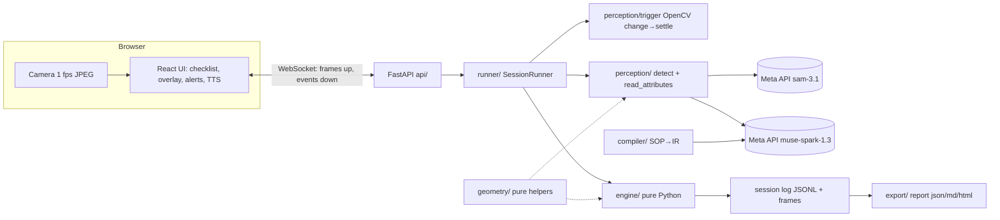
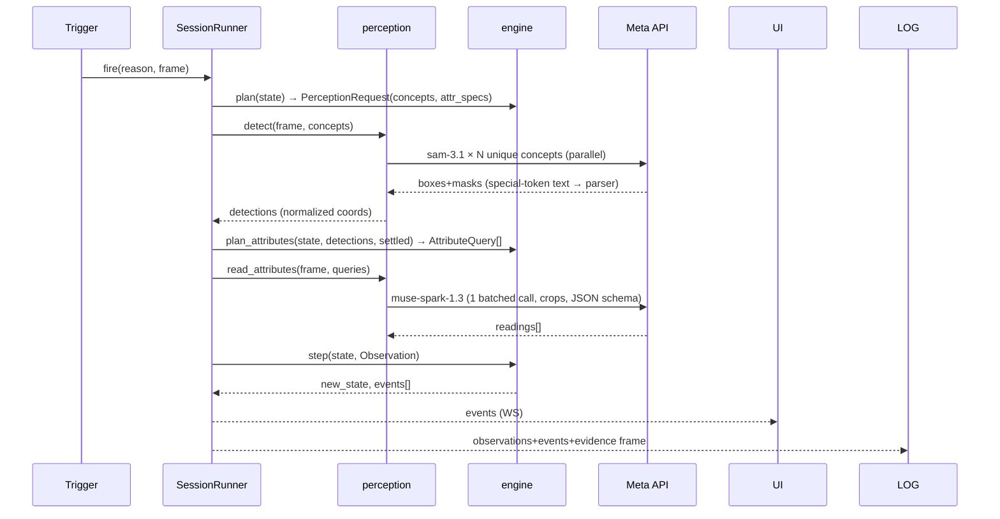
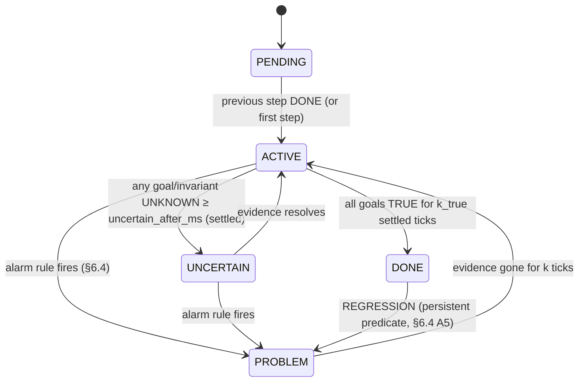

# ARCHITECTURE.md

Authoritative design. Changes require an ADR (`docs/DECISIONS.md`). Schemas: `docs/CONTRACTS.md`. Meta API facts: `docs/META_API.md`.

## 1. System overview

**Principle:** *models see and read; Python decides.* SAM localises, Spark answers narrow visual questions and compiles text; the engine alone turns evidence into statuses and alerts.

## 2. Modules & dependency rules
| Package (`backend/benchguard/`) | Responsibility | May import | Owner |
|---|---|---|---|
| `contracts/` | Pydantic models, enums, JSON Schema export | stdlib, pydantic | shared |
| `geometry/` | **Pure** box math: IoU, containment, relations, slot resolution, crop boxes | contracts | A |
| `engine/` | **Pure** predicate evaluation, step state machine, alarm rules, `plan()` | contracts, geometry | A |
| `compiler/` | SOP text/PDF → Procedure IR (+ pure `lint.py`) | contracts, meta_client | A |
| `meta_client/` | Thin async wrapper over `openai` SDK; retries; cassettes; rate-limit handling | contracts | B |
| `perception/` | `FrameSource`, `Trigger`, `detect()`, `read_attributes()`, SAM output parsing, crops, preflight metrics | contracts, geometry, meta_client | B |
| `runner/` | `SessionRunner`: orchestrates tick loop, owns clock, event bus, log | all of the above | A (+B review) |
| `export/` | JSON/MD/HTML reports from log | contracts | A |
| `api/` | FastAPI routes + WebSocket; thin | runner, compiler, export | A |
`engine/` imports **only** `contracts` + `geometry` + stdlib. `perception/` and `engine/` never import each other; `runner/` wires them. `frontend/` talks only via `docs/CONTRACTS.md` APIs and generated types.

## 3. Process & concurrency model
- Single FastAPI process, `asyncio`. One `SessionRunner` task per session. Frames arrive over WS into a **ring buffer** (last 5 full-res JPEGs + 160×90 gray thumbnails).
- **One tick in flight per session.** If a trigger fires during a tick, it sets `pending_trigger=True`; after the tick ends one more tick runs on the newest frame (coalescing).
- Within a tick: SAM calls run in parallel (`asyncio.gather`, semaphore = `perception.max_parallel_sam`, default 6); Spark attribute call is **one batched request**.
- Tick deadline: `tick_deadline_ms` (default 10 000). On expiry the tick finishes with what returned; missing model results → `UNKNOWN`.
- Time is **injected**: `runner` passes `t_ms` (session-relative, from frame timestamps) into the engine. Live = wall clock; replay = frame timestamps (virtual) — engine never reads a clock.

## 4. Tick pipeline

**Cheap first:** `plan_attributes` returns no queries unless the target object is detected, unoccluded, its `gate` (if any) is TRUE, and the scene is settled.
**Concept set** = union of `concept` of every object referenced by any step not DONE (goal, invariant, signature) + persistent predicates of DONE steps + `hand`. `slot`-mapped objects share one SAM call per concept.

## 5. Trigger (deterministic, OpenCV, `perception/trigger.py`)
State machine on 160×90 grayscale, Gaussian-blurred frames vs rolling reference:
```
IDLE --(changed_ratio > move_ratio)--> MOVING
MOVING --(changed_ratio < still_ratio for ≥ settle_ms)--> SETTLED → emit tick(reason="change") → IDLE (reference updated)
Any state --(Check now)--> emit tick(reason="manual", settled=True)
IDLE --(no tick for heartbeat_ms and a step is ACTIVE)--> emit tick(reason="heartbeat")
```
`Observation.settled` = trigger state at capture (False only if forced during MOVING). Best frame = sharpest (Laplacian variance) of last 3 frames within the settle window. Defaults in `config/perception.yaml`: `move_ratio 0.02, still_ratio 0.005, settle_ms 700, heartbeat_ms 6000`.

## 6. Engine semantics (the heart — pure, deterministic)
### 6.1 Tri-state predicate evaluation
`evaluate(pred, obs, objects) → (TRUE|FALSE|UNKNOWN, confidence, reason_code)`. Objects resolve via `geometry.resolve` (concept detections ≥ `det_score_min`; `slot` = k-th of n along an axis; count ≠ n ⇒ `UNKNOWN: SLOT_COUNT_MISMATCH`). An object is **occluded** if `intersection(hand_box, object_box) / area(object_box) ≥ occlusion_overlap` ⇒ any predicate touching it → `UNKNOWN: OCCLUDED`.
| Kind | TRUE | FALSE | UNKNOWN |
|---|---|---|---|
| `present` | count in [min,max]; conf = min detection score | count < min (conf = `absence_conf`) or > max | occluded / model error |
| `absent` | count == 0 | count > 0 | occluded / error |
| `relation` (+`negate`) | geometric relation holds (§6.2) | both operands present & relation fails | any operand missing/occluded |
| `order_along` | centres strictly increasing along axis | all present, order wrong | any missing/occluded |
| `attribute` | reading ∈ `allowed`, conf ≥ `vlm_conf_min` | reading ∉ `allowed` ∪ `pending` ∪ {`unclear`}, conf ≥ `alarm_conf_min` ⇒ **evidence** | gate not TRUE / reading `unclear` or low conf / missing |
| `confirm` | user confirmed | — | until confirmed |
**Reading ∈ `pending`** → result `FALSE` with `benign=true` (not yet done, **no alarm**).

### 6.2 Geometry (normalized coords, `geometry/relations.py`)
`inside(a,b)`: area(a∩b)/area(a) ≥ 0.8 · `overlaps`: IoU > 0 · `left_of/right_of/above/below`: centre delta > `rel_margin` (0.01) · `near`: gap ≤ 0.5 × max(box dim) of b.

### 6.3 Step state machine

Active step = lowest-index step not DONE (manual-done counts as DONE with `source="manual"`). A step satisfied **early** (goals TRUE while an earlier step is not DONE) gets `satisfied_early=true`; it turns DONE only after earlier steps are DONE.

### 6.4 Alarm rules — **positive evidence only** (R4)
Red alerts need **all** of: scene `settled`, objects not occluded, confidence ≥ `alarm_conf_min` (0.70), and the rule's K consecutive ticks. **`present` FALSE, `UNKNOWN`, low confidence, and "step not done yet" never alarm.**
| Rule | Evidence | ErrorType | K |
|---|---|---|---|
| A1 attribute | reading confidently ∉ `allowed` ∪ `pending` (object present, gate TRUE) | by `category`: orientation→`WRONG_ORIENTATION`, state→`WRONG_STATE`, identity→`WRONG_OBJECT` | `k_false_evidence`=2 |
| A2 invariant geometry | `role=invariant` `relation`/`order_along` FALSE with all operands present | `WRONG_POSITION` | 2 |
| A3 signature | all predicates of a declared `Step.errors[i].when` TRUE | that signature's type | `k_true`=2 |
| A4 order | step j>active has all goals TRUE (K) while active step not DONE | `WRONG_ORDER` (`step_id`=expected step, `related_step_id`=j); reclassified `SKIPPED_STEP` if the expected step's goals still not TRUE `skip_reclass_ms` (20 s) later | `k_true` |
| A5 regression | persistent predicate of a DONE step now fails by A1/A2 evidence, or `present` FALSE ≥ `k_false_absence`=3 settled, unoccluded ticks | `REGRESSION` | per rule |
| Finish | steps not DONE | listed `INCOMPLETE` (not an alert) | — |
Precedence when several fire on one step: `WRONG_ORDER > SKIPPED_STEP > REGRESSION > WRONG_POSITION > WRONG_ORIENTATION > WRONG_OBJECT > WRONG_STATE`. One open alert per (step, error_type); `alert_cooldown_ms` (15 s) after resolution before re-raising the same one. Alerts resolve when evidence is absent for K ticks, or step DONE (`resolution` recorded).
**Amber (no alert):** UNKNOWN persisting ≥ `uncertain_after_ms` (6 s) while settled; or model failure ⇒ "verification unavailable".
**Lint corollary:** a `goal` must not be TRUE in the initial state. Preflight runs all goals on the preflight observation; any TRUE ⇒ `goal_true_at_start` warning (user must edit).

### 6.5 Engine API (all pure)
```python
plan(proc, state) -> PerceptionRequest
plan_attributes(proc, state, detections, settled) -> list[AttributeQuery]
step(proc, state, obs, cfg) -> tuple[SessionState, list[Event]]
manual(proc, state, action: ManualAction, t_ms) -> tuple[SessionState, list[Event]]
finish(proc, state, t_ms) -> tuple[SessionState, list[Event]]
```
Property tests (hypothesis): determinism; DONE never reverts without a `REGRESSION` event; no `alert.raised` when all results are UNKNOWN; no alert while `settled=False`.

### 6.6 Default parameters (`config/engine.yaml`; tune only before `eval-freeze-v1`)
`det_score_min 0.5 · occlusion_overlap 0.25 · k_true 2 · k_false_evidence 2 · k_false_absence 3 · vlm_conf_min 0.6 · alarm_conf_min 0.7 · absence_conf 0.7 · uncertain_after_ms 6000 · skip_reclass_ms 20000 · alert_cooldown_ms 15000 · attr_lookahead_steps 2` (geometry lookahead = all remaining steps).

## 7. Perception details
- **SAM call:** Responses API, `model="sam-3.1"`, `input_text=<concept>`, `input_image=<base64 JPEG data URL>`, `metadata={"include_confidence":"true","mask_encoding":"one_bit"}`; non-streaming is acceptable (same output); parse with `meta-sam-parser` behind `perception/sam_output.py` (verify entry points: spike S2). Coordinates → normalized [0,1]. Keep boxes in contracts; keep masks only as SVG path for the active overlay (size cap).
- **Frame size:** capture 1280×720; send ≤ 1280 px wide JPEG q≈0.8 to SAM. Never send an `w:h` that mismatches the image (400).
- **Attribute readings:** crop = object box padded 15 % (clamped), resized ≤ 384 px; up to 6 crops per Spark call (multi-image), `response_format=json_schema` returning `[{query_id, value, confidence, evidence}]` with `value` an enum from the query's closed set + `unclear`. System prompt minimal; question per query; **no step/procedure context** (prevents the model "judging"). Spark never sees the SOP in this path.
- **Preflight:** run `detect()` on the current frame for all concepts; compare counts with `ObjectDef.expected_count`; compute blur (Laplacian var) and brightness; run engine goals for `goal_true_at_start`. Result → UI (`preflight.result`).
- **Cassettes (F-15):** `CASSETTE=record|replay|off`. Key = sha256(model + canonical request JSON with image bytes replaced by their sha256). Stored under `data/cassettes/` (gitignored); curated, scrubbed samples in `fixtures/cassettes/`.

## 8. Compiler (`compiler/`)
`compile(sop_text|pdf) -> Procedure`: (1) Spark call with `response_format=json_schema` of the IR (flattened, depth ≤ 10), SOP inside delimiters, system prompt: closed vocabulary, SAM concept rules (≤ 4 words, one noun phrase, concrete attributes, no commas/negation), "do not invent steps". (2) Pydantic validation. (3) **Pure lint** (`lint.py`): ids unique/snake_case, every referenced object defined, concepts legal, ≥ 1 `goal` per step, `depends_on` acyclic, attribute `allowed` non-empty & `pending` disjoint, slot `index < of`, goal-not-TRUE-at-start check deferred to preflight. (4) Return IR + warnings. Failure → `CompileError(code, details)`. Temperature low; compile ≤ 3 attempts with lint errors fed back as text.

## 9. Failure handling & degradation
| Failure | Handling |
|---|---|
| 429 | Exponential backoff (500 ms ×2, jitter, honour `Retry-After`), ≤ 3 tries within tick deadline |
| 5xx / timeout | 1 retry; then tick `degraded`; dependent predicates `UNKNOWN`; UI amber "verification unavailable" + manual confirm |
| 400 (bad prompt/aspect ratio) | Programming error: log with request summary, no retry, tick degraded, raise in dev |
| 404 `model_not_found` | Fatal config error shown at session start (preflight model check) |
| Spark returns invalid JSON (should not under constrained decoding) | 1 retry then `UNKNOWN` |
| Zero SAM matches | Normal result (count 0) |
| WS disconnect | Runner keeps session 60 s; client resumes via `session_id`; else auto-finish |
| Call budget exceeded (400) | Session → `PAUSED_BUDGET`; manual-confirm mode only |
| Camera denied / lost | UI error state; session paused |

## 10. Persistence
No DB. `data/sessions/<session_id>/`: `procedure.json`, `observations.jsonl`, `events.jsonl`, `frames/<tick_id>.jpg` (+ `evidence/`), `report.json`, `report.md`, optional `report.html`. `data/` is gitignored. Evidence frames referenced by `frame_id` in events.

## 11. Technology choices (and rejected alternatives)
| Choice | Why | Rejected |
|---|---|---|
| FastAPI + WebSocket | async, typed, one process; client→server frames need WS | Flask (sync), SSE (one-way) |
| Pydantic v2 as contract source → JSON Schema → TS types | single truth for 2 devs, validates model output | hand-written TS types |
| `openai` SDK with `base_url=https://api.meta.ai/v1` | documented path; supports Chat Completions + Responses | custom HTTP |
| Chat Completions + `response_format` for Spark; Responses for SAM | SAM only on Responses; schema shape for Chat Completions verified in docs | Spark via Responses `text.format` (shape unverified) |
| OpenCV (headless) for trigger/crops/quality | tiny, deterministic | ML-based change detection |
| React + Vite + TS, hooks only | fast, typed | Next.js (SSR unnecessary) |
| Filesystem JSONL | zero setup, diffable, replayable | SQLite/Postgres/Redis |
| Python-owned engine | testable, deterministic, matches project principle | LLM judge / agent loop |

## 12. Observability
JSON logs: `ts, level, session_id, tick_id, module, event, latency_ms{sam,spark,total}, model, n_calls`. UI latency badge shows last tick total. `eval/` aggregates `observations.jsonl` for latency stats.
